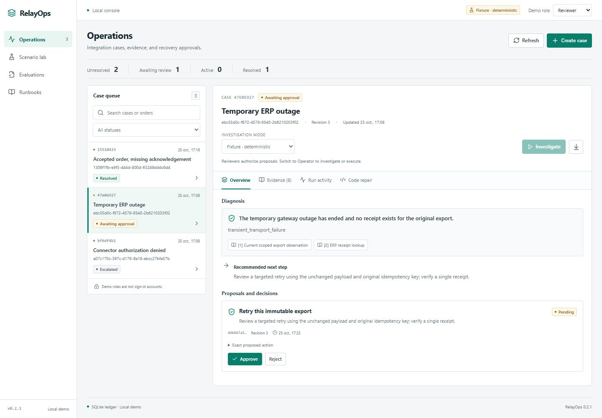
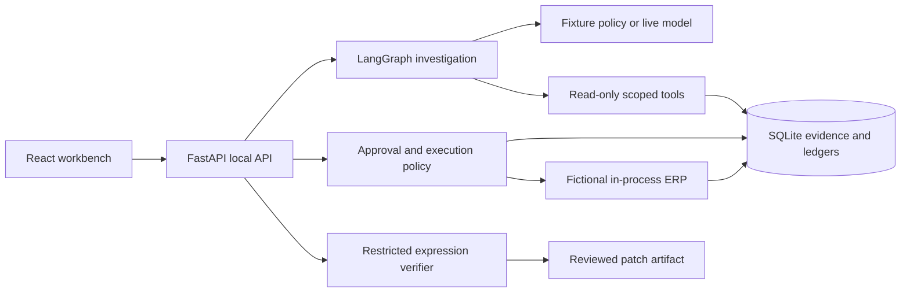

# RelayOps

[](https://github.com/Mahou-Mehdi/relayops/actions/workflows/ci.yml)

RelayOps is a local workbench for investigating failed ERP exports and reviewing recovery actions. It uses FastAPI, React, LangGraph, and SQLite. The included integrations use fictional orders and suppliers; no SAP account or model key is needed to try them.

An example: an order reaches the target, but its acknowledgement is lost. The case needs receipt reconciliation rather than a new export. RelayOps checks the target receipt, proposes reconciliation, and waits for a reviewer to approve the exact action. An operator executes it, then the application reads back the result.



## What's implemented

- **Investigation:** scoped evidence reads, receipt lookup, runbook search, and a diagnosis with source citations.
- **Review and execution:** approvals bind the action hash, target revisions, and expiry. A recommendation cannot authorize itself.
- **Recovery:** retry an unchanged export or reconcile an existing receipt. Repeated execution returns the recorded result.
- **Mapping repair:** inspect a failing decimal expression, verify a candidate against independent expected values, and export the reviewed diff.
- **Evaluation:** run eight deterministic scenarios, inspect outcome checks, select saved reports, and download their JSON.

Cases, evidence, approvals, operations, and evaluation reports are stored locally. The default fixture policy follows explicit error codes and makes no model calls. An optional live provider selects tools and proposes diagnoses or repair expressions through the same application controls.

Changes by version are in the [changelog](CHANGELOG.md).

## Run locally

Requirements: **Python 3.11+** and **Node.js 22.12+ on the Node 22 line, or Node 24**, with npm. Python 3.12 is used in the Windows commands below. Run from a Git checkout: the application reads its fixture files and built dashboard from this repository.

```console
git clone https://github.com/Mahou-Mehdi/relayops.git
cd relayops
```

### Windows PowerShell

Use the Python launcher to select Python 3 explicitly; a bare `python` command may point to an older installation. These commands do not require virtual-environment activation or an execution-policy change.

```powershell
py -3.12 -m venv .venv
.\.venv\Scripts\python.exe -m pip install -r requirements.lock
.\.venv\Scripts\python.exe -m pip install --no-deps -e .
cd web
npm ci
npm run build
cd ..
.\.venv\Scripts\python.exe -m relayops
```

### macOS / Linux

```sh
python3 -m venv .venv
.venv/bin/python -m pip install -r requirements.lock
.venv/bin/python -m pip install --no-deps -e .
cd web
npm ci
npm run build
cd ..
.venv/bin/python -m relayops
```

Open **http://127.0.0.1:8765**. The supported launcher serves the built dashboard and API from one origin, with one server process. The initial case queue is empty; **Scenario lab** creates isolated fictional incidents.

The default database is `runtime/relayops.sqlite`. Stop the server before changing databases. To start a separate workspace without deleting history:

```powershell
.\.venv\Scripts\python.exe -m relayops --db runtime/another-workspace.sqlite --port 8766
```

Use `.venv/bin/python` in the equivalent Unix command. `RELAYOPS_DB` and `RELAYOPS_PORT` also set these defaults. `RELAYOPS_ENV` must be unset or `local`.

## Optional live model

Choose a model available to your API account that supports the Responses API and the structured function-call schema used by the provider. **There is no default model and no automatic fallback to a fixture answer.** Start the server with both variables set, then select **OpenAI** in the case's investigation-mode menu.

```powershell
$env:OPENAI_API_KEY = "your-api-key"
$env:RELAYOPS_MODEL = "your-compatible-model-id"
.\.venv\Scripts\python.exe -m relayops
```

```sh
export OPENAI_API_KEY="your-api-key"
export RELAYOPS_MODEL="your-compatible-model-id"
.venv/bin/python -m relayops
```

These are placeholders; choose your own credentials and model. The application **does not automatically load `.env` files**. Credentials remain on the server; the UI receives only whether live mode is available and the configured model name.

Live mode sends the selected fictional case evidence, relevant runbooks, and coding context to `api.openai.com`. API charges apply. Investigations allow at most 10 model calls and 20 tool calls, with a 180-second budget checked between steps. A model request has bounded network timeouts and may still be settling when cancellation is requested. Each response is limited to 1,800 output tokens. These are execution bounds, not a monetary budget; token usage is reported when provided, and the application does not invent a dollar estimate. Live repair uses a separate proposal request and is not included in the investigation run's usage totals.

## Start with these cases

1. **Accepted order, missing acknowledgement:** look up the existing receipt, approve reconciliation as Reviewer, then execute as Operator. The target still has one receipt.
2. **Decimal amount mapping defect:** diagnose premature rounding, prepare a restricted repair, inspect baseline versus candidate checks and the diff, then review and export the patch. Export does not deploy code or resolve the failed business export.
3. **Untrusted instructions inside a log:** inspect the malicious-looking text as evidence. The investigator cannot call permission-changing or arbitrary network tools; recovery still requires an exact, current approval.

The [demo guide](docs/demo.md) walks through these and the remaining scenarios.

## Verify behavior

From the repository root, using the virtual environment:

```powershell
.\.venv\Scripts\python.exe -m pytest
.\.venv\Scripts\python.exe -m relayops --evaluate --report runtime/evaluation-report.json
cd web
npm test
npm run build
```

On Unix, replace the Python executable with `.venv/bin/python`. The dashboard's **Evaluations → Run regression** runs the eight scenarios against a temporary database without modifying your cases. Its reports are saved in the workspace database and survive server restarts. The CLI prints a report and optionally saves it with `--report`; CLI reports do not appear in dashboard history.

Automated tests cover diagnosis, approvals, receipts, replay, repair exports, and report persistence. Fault-injection tests deliberately break recovery paths and require the evaluator to report a failure. The eight fixture scenarios are deterministic system regressions; their check counts do not measure live-model accuracy or performance on unseen incidents. See [evaluation details](docs/evaluations.md).

CI runs on Python 3.11 and 3.12 with Node 22 for dashboard tests and the production build. JSON evaluation reports are retained as Actions artifacts for 30 days. Model transport tests use mocked responses and a scripted provider.

The decimal repair fixture passes **8/16** protected checks before correction and **16/16** afterward. Component tests also compare 300 seeded inputs against an independent integer-arithmetic oracle. The [coding boundary](docs/coding-boundary.md) describes the expression grammar and its limits.

## Architecture and scope



- The current graph has one investigator, not a team of autonomous agents.
- Demo personas illustrate authorization rules; they are public header values, **not authentication**. Keep the service local. See [SECURITY.md](SECURITY.md).
- Application and fictional ERP records share a SQLite database. Atomic simulator updates do not establish exactly-once delivery to a remote ERP.
- A restart retains records and marks unfinished investigations interrupted. Start a new investigation; opaque model execution does not resume from a checkpoint.
- Repairs use a trusted interpreter for a tiny expression grammar. No generated shell, Python, or JavaScript executes; no arbitrary-code sandbox is present.
- SAP integration, MCP servers, distributed workers, monetary budgets, isolated repository repair, and comparative model evaluations remain planned work.

Read [architecture](docs/architecture.md) for the state and trust boundaries, and [roadmap](docs/roadmap.md) for the staged control-center plan and its acceptance criteria.

## Repository map

```text
relayops/       API, LangGraph workflow, provider, domain policy, SQLite store
web/           React/TypeScript dashboard and UI policy tests
fixtures/      Restricted expression and independent expected results
tests/         Backend and repair regression tests
docs/          Architecture, demonstrations, coding boundary, roadmap
runtime/       Local working data; not application source
```

Maintained by [Mahou Mehdi](https://github.com/Mahou-Mehdi). [MIT license](LICENSE).
