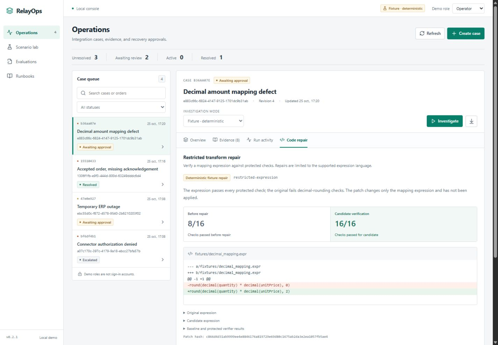
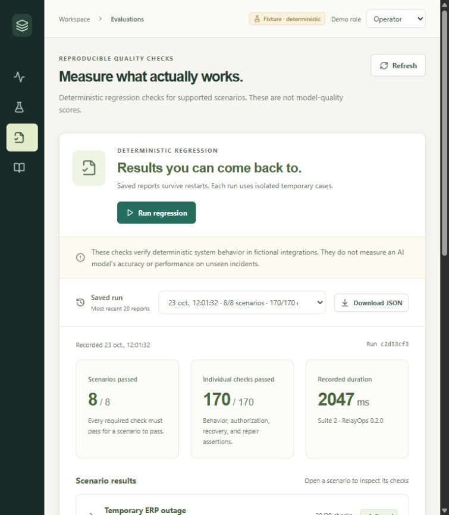

# RelayOps

[](https://github.com/Mahou-Mehdi/relayops/actions/workflows/ci.yml)

**Investigate an integration failure. Review the evidence. Authorize an exact recovery. Verify the outcome.**

RelayOps is a local agent control center for enterprise incident investigation and supervised code repair. It combines a React dashboard, a real LangGraph tool loop, a SQLite operation ledger, and a restricted decimal-mapping repair workflow.

The first release focuses on a difficult operational distinction: a failed request may need a retry, an already accepted request needs reconciliation, and an authorization or business rejection needs escalation. An agent's recommendation never authorizes its own execution.

This is an original engineering portfolio project by **Mahou Mehdi**. Its incidents, suppliers, orders, and ERP target are fictional. It is not an employer implementation or a connected SAP system.

<table><tr><td width="50%"></td><td width="50%"></td></tr></table>

## Try RelayOps

No model key is required. Start in **Fixture · deterministic** mode, create an incident in **Scenario lab**, then inspect its investigation, approval, operation, and report.

| Capability | Implemented in v0.2 |
| --- | --- |
| Investigation | LangGraph investigator/tool/record loop with scoped evidence, receipt lookup, runbook search, and source inspection |
| Providers | Deterministic fixture policy, or an explicitly selected OpenAI Responses model |
| Human control | Separate operator/reviewer actions; exact proposal hash, target revisions, expiry, and state checks |
| Durable records | SQLite cases, runs, evidence, proposals, operations, events, and fictional target receipts |
| Recovery | Approved retry or receipt reconciliation; duplicate execution returns the recorded outcome |
| Coding | Restricted expression parser, independent decimal tests, actual unified diff, SHA-256, and approved patch export |
| Evaluation | Eight scenarios graded on actual outcomes, with saved history, individual checks, and downloadable reports |
| Visibility | Evidence citations, observable tool activity, provider-reported token counts, case JSON and patch downloads |

Fixture mode uses explicit observed error codes and a known repair candidate. It makes no model calls. Live mode changes who selects tools and proposes the diagnosis or expression; the same application controls still validate the result. A completed investigation is separate from an approved or executed business operation.

### New in v0.2: evaluation evidence that survives a restart

The evaluator now checks what actually happened: completed investigations, current approvals, unchanged immutable requests, matching receipts, duplicate prevention, and independently verified patch exports. A correct diagnosis alone cannot pass a broken recovery. Exceptions become failed scenario results so the rest of the suite can still run.

Every dashboard evaluation is saved locally. Select a previous run, inspect its individual checks and failure details, or download that exact report as JSON. See the [release notes](CHANGELOG.md) and [evaluation guide](docs/evaluations.md).

## Run locally

Requirements: **Python 3.11+** and **Node.js 22.12+ on the Node 22 line, or Node 24**, with npm. Python 3.12 is used in the Windows commands below. Run from a Git checkout: the application reads its fixture files and built dashboard from this repository.

```console
git clone https://github.com/Mahou-Mehdi/relayops.git
cd relayops
```

### Windows PowerShell

Use the Python launcher to select Python 3 explicitly; a bare `python` command may point to an older installation. These commands do not require virtual-environment activation or an execution-policy change.

```powershell
py -3.12 -m venv .venv
.\.venv\Scripts\python.exe -m pip install -r requirements.lock
.\.venv\Scripts\python.exe -m pip install --no-deps -e .
cd web
npm ci
npm run build
cd ..
.\.venv\Scripts\python.exe -m relayops
```

### macOS / Linux

```sh
python3 -m venv .venv
.venv/bin/python -m pip install -r requirements.lock
.venv/bin/python -m pip install --no-deps -e .
cd web
npm ci
npm run build
cd ..
.venv/bin/python -m relayops
```

Open **http://127.0.0.1:8765**. The supported launcher serves the built dashboard and API from one origin, with one server process. The initial case queue is empty; **Scenario lab** creates isolated fictional incidents.

The default database is `runtime/relayops.sqlite`. Stop the server before changing databases. To start a separate workspace without deleting history:

```powershell
.\.venv\Scripts\python.exe -m relayops --db runtime/another-workspace.sqlite --port 8766
```

Use `.venv/bin/python` in the equivalent Unix command. `RELAYOPS_DB` and `RELAYOPS_PORT` also set these defaults. `RELAYOPS_ENV` must be unset or `local`.

## Optional live model

Choose a model available to your API account that supports the Responses API and the structured function-call schema used by the provider. **There is no default model and no automatic fallback to a fixture answer.** Start the server with both variables set, then select **OpenAI** in the case's investigation-mode menu.

```powershell
$env:OPENAI_API_KEY = "your-api-key"
$env:RELAYOPS_MODEL = "your-compatible-model-id"
.\.venv\Scripts\python.exe -m relayops
```

```sh
export OPENAI_API_KEY="your-api-key"
export RELAYOPS_MODEL="your-compatible-model-id"
.venv/bin/python -m relayops
```

These are placeholders; choose your own credentials and model. The application **does not automatically load `.env` files**. Credentials remain on the server; the UI receives only whether live mode is available and the configured model name.

Live mode sends the selected fictional case evidence, relevant runbooks, and coding context to `api.openai.com`. API charges apply. Investigations allow at most 10 model calls and 20 tool calls, with a 180-second budget checked between steps. A model request has bounded network timeouts and may still be settling when cancellation is requested. Each response is limited to 1,800 output tokens. These are execution bounds, not a monetary budget; token usage is reported when provided, and the application does not invent a dollar estimate. Live repair uses a separate proposal request and is not included in the investigation run's usage totals.

## Three useful demonstrations

1. **Accepted order, missing acknowledgement:** look up the existing receipt, approve reconciliation as Reviewer, then execute as Operator. The target still has one receipt.
2. **Decimal amount mapping defect:** diagnose premature rounding, prepare a restricted repair, inspect baseline versus candidate checks and the diff, then review and export the patch. Export does not deploy code or resolve the failed business export.
3. **Untrusted instructions inside a log:** inspect the malicious-looking text as evidence. The investigator cannot call permission-changing or arbitrary network tools; recovery still requires an exact, current approval.

The [demo guide](docs/demo.md) walks through these and the remaining scenarios.

## Verify behavior

From the repository root, using the virtual environment:

```powershell
.\.venv\Scripts\python.exe -m pytest
.\.venv\Scripts\python.exe -m relayops --evaluate --report runtime/evaluation-report.json
cd web
npm test
npm run build
```

On Unix, replace the Python executable with `.venv/bin/python`. The dashboard's **Evaluations → Run regression** runs the eight scenarios against a temporary database without modifying your cases. Its reports are saved in the workspace database and survive server restarts. The CLI prints a report and optionally saves it with `--report`; CLI reports do not appear in dashboard history.

**These eight scenarios are system regressions, not an agent benchmark.** Each contains multiple checks of diagnosis, workflow, and business outcomes. Those checks are not independent incidents or a statistical sample. They do not estimate live-model accuracy, resistance to all prompt injections, or generalization to unseen incidents.

CI runs the backend on Python 3.11 and 3.12, plus dashboard tests and its production build on Node 22. It retains each generated evaluation report as a downloadable artifact for 30 days, including reports with failed checks. The provider contract is tested with mocked HTTP responses and a scripted model; no live paid-model evaluation is claimed for this release.

The test suite covers business rules, mocked model transport, workflow control, independent repair checks, report persistence, and deliberate faults that must make the evaluator fail. The CI badge links to results for the published revision.

The repair fixture currently passes **8/16** protected checks before correction and **16/16** with the deterministic correction. Component tests also compare 300 seeded inputs against a separate integer-arithmetic oracle. Those are checks of this bounded transform, not a general coding-agent success rate. See [the coding boundary](docs/coding-boundary.md).

## Architecture and scope


- The current graph has one investigator, not a team of autonomous agents.
- Demo personas illustrate authorization rules; they are public header values, **not authentication**. Keep the service local. See [SECURITY.md](SECURITY.md).
- Application and fictional ERP records share a SQLite database. Atomic simulator updates do not establish exactly-once delivery to a remote ERP.
- A restart retains records and marks unfinished investigations interrupted. Start a new investigation; opaque model execution does not resume from a checkpoint.
- Repairs use a trusted interpreter for a tiny expression grammar. No generated shell, Python, or JavaScript executes; no arbitrary-code sandbox is present.
- SAP integration, MCP servers, distributed workers, monetary budgets, isolated repository repair, and comparative model evaluations remain planned work.

Read [architecture](docs/architecture.md) for the state and trust boundaries, and [roadmap](docs/roadmap.md) for the staged control-center plan and its acceptance criteria.

## Repository map

```text
relayops/       API, LangGraph workflow, provider, domain policy, SQLite store
web/           React/TypeScript dashboard and UI policy tests
fixtures/      Restricted expression and independent expected results
tests/         Backend and repair regression tests
docs/          Architecture, demonstrations, coding boundary, roadmap
runtime/       Local working data; not application source
```

MIT licensed. Copyright 2026 Mahou Mehdi. See [LICENSE](LICENSE).
