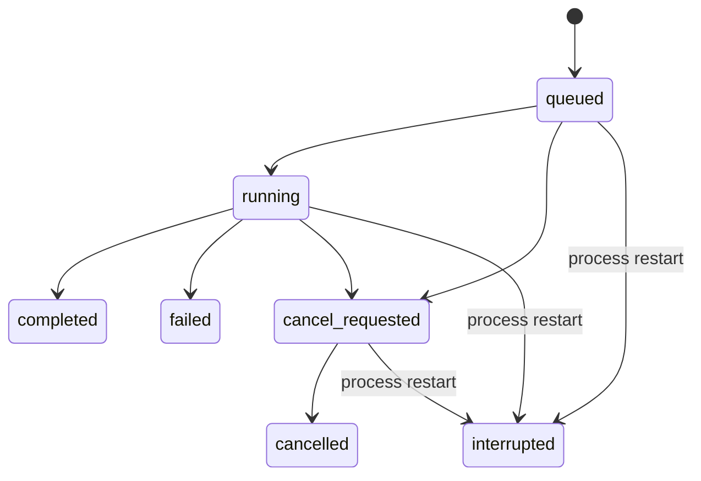
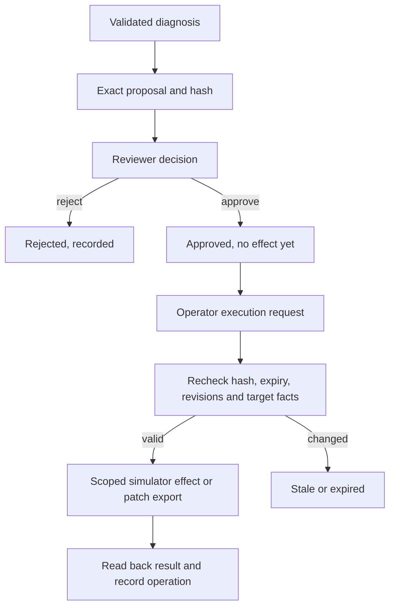

# Architecture

RelayOps v0.2 is a local, single-process application. Its design separates investigation, authorization, execution, and verification so that a model-generated recommendation never grants itself permission to change a target.

## Components

| Component | Responsibility |
| --- | --- |
| `web/src/` | React/TypeScript operations view, scenario lab, evidence, decisions, activity, repair, evaluation, and downloads |
| `relayops/app.py` | FastAPI routes, background investigation queue, persona checks, artifact endpoints, built dashboard |
| `relayops/workflow.py` | LangGraph loop, tool allowlist, case scope, evidence provenance, cancellation and call limits |
| `relayops/provider.py` | Explicitly configured Responses API transport and structured tool definitions |
| `relayops/domain.py` | Authoritative state transitions, proposals, approvals, operations, receipt readback, repair re-verification |
| `relayops/store.py` | SQLite transactions, uniqueness constraints, and persistent records |
| `relayops/repair.py` | Restricted expression parser/interpreter, independent checks, diff and digest |
| `relayops/evaluation.py` | Eight deterministic scenarios graded on workflow and business outcomes; failures isolated per scenario |
| `relayops/evaluation_history.py` | Append-only reports and ordered history in the local workspace database |

Python dependencies are bounded in `pyproject.toml` and resolved in `requirements.lock`; web dependencies are resolved by `web/package-lock.json`. The supported setup is an editable repository checkout so fixture and dashboard paths remain available.

Evaluation reports are committed after the suite completes, including completed suites containing failures. An additive SQLite schema upgrade creates the `evaluations` table without modifying existing incidents. Latest results are read from persisted history; restarting the server no longer clears them. Simulated evaluation effects still occur only in temporary databases. The API exposes no report update/delete operation. See [evaluations.md](evaluations.md).

## Investigation lifecycle

One active investigation is allowed per case, enforced by a SQLite partial unique index. The application has two worker threads and admits at most six investigation jobs at a time. A run records observable tool calls, results, status changes, and provider-reported usage. It does not expose hidden model reasoning.

The LangGraph graph is `START → investigator → tools`, loops while no diagnosis is present, and ends with `record → END`. Fixture mode walks a fixed tool sequence and applies an explicit policy to observed error codes. Live mode asks the configured model which allowlisted tool to call next. Both use the same gateway and domain validation.

Investigation tools are read-only with respect to business operations:

| Tool | Scope |
| --- | --- |
| `read_export_evidence` | Current selected case's export observation and recorded evidence |
| `lookup_receipt` | That case's original order/job/key/digest receipt |
| `search_runbooks` | Bounded query over the checked-in operational library |
| `read_connector_source` | Restricted mapping source and grammar; no protected expected answers |
| `finish_investigation` | A structured diagnosis for domain validation |

The gateway chooses the case identity from the persisted run. Read tools cannot accept a different target ID. Before finishing, a run must have read export evidence and the receipt observation; its citation IDs must belong to evidence it actually read. The domain also checks that the proposed action fits the current target facts. Citation membership does not by itself prove that every sentence is supported: live narrative correctness still requires evaluation and review.

The limits are 20 tool calls, 10 model calls, and 180 seconds checked between steps. Provider requests have a 35-second HTTP timeout, a 10-second connect timeout, and a maximum 1,800 output tokens per response. Cancellation is cooperative: it prevents subsequent workflow steps, rather than forcibly terminating an in-flight HTTP request. There is no current per-run dollar cap, token reservation system, multiagent scheduler, or retry of model-provider failures.

## Proposal and execution boundary

A proposal binds the action to its case, order, job, payload hash, idempotency key, expected target revisions/status, and expiry. The default approval window is 15 minutes. The browser submits the hash it displayed; the domain independently validates the stored hash and current target before approval and execution. New investigations and replacement repairs make earlier pending/approved proposals stale.

The model has no approve or execute tool. Reviewer decisions and operator execution are separate API actions. These roles are selected demo personas, not authenticated users or a real separation-of-duties identity system.

Repeated execution of an already executed proposal returns the recorded case. The operation table allows one operation per proposal. The target receipt table has a unique idempotency key, and receipt lookup checks case, order, job, and payload digest. Reconciliation reads an existing receipt; it does not post a new fictional order. A retry retains the original immutable payload and key.

## Persistence and its limits

SQLite stores cases, runs, proposals, operations, events, and target receipts. File databases use WAL; writes use `BEGIN IMMEDIATE` and rollback on failure. Each store operation opens its own connection, with local access serialized by the store. Foreign keys and uniqueness constraints back the application checks.

The fictional ERP has a separate ledger table but shares the same database and transaction boundary. Its effect, application state, operation, and audit event can therefore commit atomically. This is a useful local consistency demonstration; it does not implement a distributed transaction, durable outbound network queue, or remote crash-after-effect recovery.

At startup, active persisted investigations become `interrupted`. Their evidence and prior events remain available, as do approvals and completed operations. A new run can inspect that case again. The current LangGraph graph has no persistent checkpointer; the exact model/tool continuation is not restored. Completed dashboard evaluation reports survive restarts in a separate table in the workspace database; an evaluation interrupted before its report is saved is not recovered.

Audit events are application records with a sequence, not an append-only external audit service. Evidence SHA-256 values and proposal hashes detect mismatches in the supported workflow; they are not cryptographic signatures or protection from a machine owner editing the database.

## Repair boundary

The mapping-defect scenario passes a bounded source context to a deterministic candidate producer or one live model call. `prepare_repair` parses the expression, runs the original and candidate against independent expectations, and creates a real unified diff plus SHA-256.

The domain calls the verifier again instead of trusting submitted scores. Only a changed candidate passing every check when the baseline failed can create a patch-export proposal. Execution marks the artifact `patch_ready`; it does not alter the original expression file, queued business payload, or external software. The approved artifact is available through the patch endpoint and case JSON report.

See [coding-boundary.md](coding-boundary.md) for the grammar, resource bounds, test independence, and explicit limits on the word “protected.” An arbitrary-code execution environment is not part of v0.2.

## Local HTTP and live-provider boundaries

The launcher binds `127.0.0.1` with one process. Middleware rejects non-local Host names, checks same-origin writes when an Origin is present, requires `X-RelayOps-Request: 1` for mutations, and applies browser security headers. The role header is deliberately public. These controls support a local demonstration, not internet exposure or untrusted local users.

Fixture mode needs no network model service. Live mode uses a server-side API key and a fixed HTTPS Responses endpoint, disables redirects and environment-derived HTTP proxy configuration, and asks for `store: false`. This request option is not a guarantee about every aspect of the provider's retention or account policy. The application sends selected evidence to the configured provider only when live mode is explicitly chosen. Provider exceptions are summarized rather than recording arbitrary credential-bearing exception strings.

The current system uses fictional data. Connecting real enterprise evidence requires a separate review of authentication, authorization, retention, redaction, secrets, network egress, tenant isolation, and provider terms.
