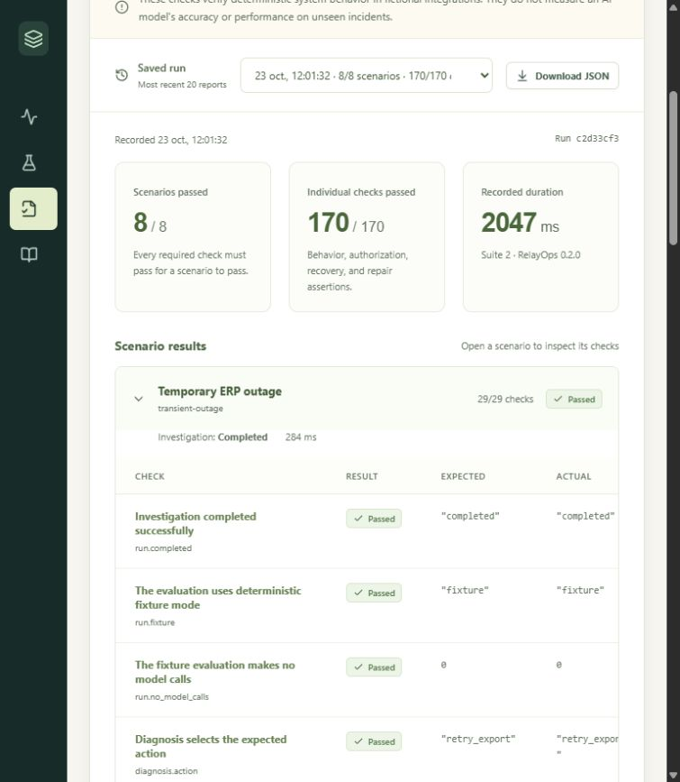

# Evaluation evidence

RelayOps v0.2 grades observable outcomes across the eight authored fictional scenarios. Reports make the distinction between a plausible diagnosis and a successfully controlled operation visible.

## What is checked

Every scenario checks the investigation's completion, fixture mode, absence of model calls, expected action and cause, citations, case disposition, and absence of business effects during investigation.

| Scenario family | Additional outcome checks |
| --- | --- |
| Transient outage and misleading log | Exactly one current retry proposal; execution refused before approval; approval alone causes no effect; one completed export and matching receipt; repeat execution changes neither target nor ledger |
| Lost acknowledgement | The same approval and receipt checks, plus preservation of the receipt that existed before investigation |
| Mapping defect | Original transform fails a nonempty verifier; candidate passes the complete verifier; actual diff matches its hash; exact reviewed patch is exported; the failed business export remains unchanged; repeated export adds no operation |
| Permission denial, business rejection, incomplete evidence | Escalated status, no proposal, no operation, and unchanged target including permission and business-policy fields |
| Healthy export | Resolved disposition, no mutation proposal or operation, and unchanged existing target/receipt |

The evaluator reads back stored state after actions rather than accepting an operation's return value as proof. Expected causes/actions are maintained separately from scenario metadata. Tests deliberately remove proposals, change receipts, alter business state during approval, falsify repair results, and add replay effects; those mutations must produce failures.

A scenario passes only when every recorded check passes and it completes without an unexpected exception. Exceptions are isolated to that scenario and recorded as a fixed stage plus exception class, such as `execution: DomainError`. Arbitrary exception messages are excluded. An early failure can reduce the number of recorded checks; it cannot turn a failed scenario into a pass.

## Use the dashboard

1. Select **Operator**, open **Evaluations**, and run the regression suite.
2. Inspect the scenario total separately from the individual-check total.
3. Expand a scenario to see each check's expected and observed values. A failed result remains inspectable and downloadable.
4. Run the suite again and select an earlier saved report. The recent-history selector shows up to 20 reports.
5. Download the selected report as JSON. Restart the server with the same `--db` path: saved history and the latest report are still available.

Observers and reviewers can read and download reports. Only operators can start a suite. These are the existing local demo personas, not authenticated identities.



## Storage and upgrades

The suite's fictional incidents and effects use a temporary SQLite database. Completed reports are appended to an `evaluations` table in the workspace database; no report update/delete API exists. A failed scenario is a completed report result and is saved along with the other results. If saving fails, the request fails rather than pretending the report was retained.

Opening an existing v0.1 database creates the new table automatically and retains its incidents, receipts, operations, and evidence. Old v0.1 reports were only in server memory, so there is no historical record to recover from a previous restart.

The history API defaults to 20 summaries and accepts a limit of 1–100. The server retains all reports; the limit only bounds a response. Completion sequence determines ordering, so identical timestamps or a backward clock adjustment do not reorder the latest result. Reports are immutable through the API, not tamper-proof against someone who can modify the database file.

If the server stops before a suite finishes and saves its report, that incomplete evaluation is not in history. Evaluation checkpoint/recovery is not implemented.

## CLI and CI artifacts

```powershell
.\.venv\Scripts\python.exe -m relayops --evaluate --report runtime/evaluation-report.json
```

Use `.venv/bin/python` on macOS/Linux. JSON is printed to standard output and saved as UTF-8 to the supplied path. A failing suite still writes its report and exits with code 1. `--report` requires `--evaluate`. An explicitly selected existing report file is replaced; choose a different filename to retain multiple CLI runs.

CLI evaluation does not add to dashboard history. GitHub CI uses this command for each Python version and uploads the report as an Actions artifact, retained for 30 days. A workflow that fails before producing a report cannot upload one.

## Report identity and interpretation

Each report has a UUID, completion timestamp, application version, `schema_version: 1`, and `suite_version: "2"`. Scenario rows use stable scenario IDs; check rows use descriptive IDs within their scenario. A report includes the actual values used to grade each check, with measured durations. Temporary incident IDs, if present in values, are evidence from that isolated run and are not links to dashboard cases.

Schema version identifies the JSON structure. Suite version identifies the grading contract. A version label does not prove which uncommitted source or dependencies were present; preserve the Git revision and environment alongside exported results for an external experiment. Automatic cross-version comparisons are not implemented.

The eight scenarios and their individual checks are **deterministic system regressions**. Increasing the check count does not create additional independent cases, establish live-model accuracy, or measure resistance to every injection. The target remains an in-process fictional ERP sharing the simulator's database. Remote crash recovery, live-model comparisons, and held-out evaluation data remain roadmap work.
